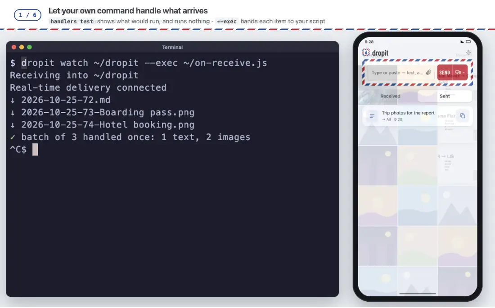

# dropit for the terminal

**English** · [简体中文](./README.zh-CN.md)

**Your clipboard, a file, a script's result — on your phone and every other device, in one line.
And a folder that fills itself with whatever you send from elsewhere.**

macOS and Linux. A single Node.js file, no dependencies.



<sub>Shown: a Lonely Planet page link · a NASA photograph (public domain).</sub>

## One line each

| You want… | Run | You see |
|---|---|---|
| What you just copied, on your phone | `pbpaste \| dropit send` | `✓ Sent #41  → All · 14:19` |
| A file on your phone | `dropit send -f ~/Desktop/report.pdf` | `✓ Sent #42  → All · 14:19` |
| A quick note to yourself | `dropit send "call the bank at 3"` | `✓ Sent #43  → All · 14:19` |
| To hear when a long job is done | `make release && dropit send "release built ✅"` | the note arrives when it finishes |
| A command's output somewhere you can read it | `git log -5 --oneline \| dropit send` | the five lines, as one item |
| Everything you send from elsewhere, as files here | `dropit watch ~/dropit` | `↓ 2026-10-04-44.md`, `↓ 2026-10-04-45-IMG_2041.jpeg` … |

Several words become one item: `dropit send see you at 6` sends *see you at 6*.
A lone `http(s)://` address is sent as a link; anything else as text.

## Sending

```bash
dropit send "some text"            # text, or a single link
some-command | dropit send         # whatever comes down the pipe, as one item
dropit send < notes.txt            # a text file's contents
dropit send -f photo.jpg           # a file: image, video, PDF, anything
```

- **A note with the files:** `dropit send "the signed copy" -f contract.pdf` — the text goes first, in the same batch as the files.
- **Several files at once:** `dropit send -f *.png` — up to 10, sent as one batch that arrives together.
  More than 10 and nothing is sent; a missing file is caught before anything goes. One line per file, then one that says where it went.
- **A failed batch stops there:** what already went stays sent, the files that did not go are listed, and so is the command that
  sends just those again to the same devices, into the same batch, each in the place it had (`dropit send -f b.jpg d.jpg --to 'My Pixel' --batch <id> --of 5 --at 2,4`);
  the receiving end still shows them as one batch. The exit code is `1`.
- **To some devices only:** `dropit send --to "My Pixel" "see you at 3"`, or `dropit send -f a.jpg b.jpg --to "My Pixel,Home Linux"`.
  Names or ids (`dropit devices` shows both), separated by commas; `--to all` is every device. Case and spaces in a name don't matter.
  A device whose name has a comma in it, or is called "all", can only be given by its id.
  If two devices share a name, nothing is sent: the error lists their ids, and you use one of those. `--to` is for this send only, and
  the receipt says so (`→ My Pixel · this once; default unchanged`). A token that can only send, not receive, can't read the device list, so names don't work for it (`--to all` does).
- **A default for this computer:** `dropit target` shows it; `dropit target "My Pixel" "Home Linux"` sets it (`dropit target all` or
  `dropit target clear` goes back to every device). It is kept in this computer's config file, nowhere else, so pairing again or
  reinstalling starts from "all" again. With "all" a send carries no list, and devices that join later receive too; with a chosen
  few it names them, and devices that join later do not. A device that has since been removed leaves the default, and you are told once.
- **Big files stream** from disk; they aren't read into memory first. Your plan sets the size limit per file.
- **Sent twice by accident?** The same thing twice in a row within a minute is kept once — you see `Already sent (#41)`.
- **Scripts can rely on it:** success exits `0`; any failure prints the reason to stderr and exits `1`.

## A folder that fills itself

```bash
dropit watch ~/dropit            # the folder is remembered: next time, just `dropit watch`
```

It catches up on everything that arrived while it wasn't running, then stays connected and writes each
new item the moment it arrives:

| Sent from elsewhere | Lands here as |
|---|---|
| Text, a link | `2026-10-04-44.md` |
| A file | `2026-10-04-45-IMG_2041.jpeg`, saved as it is |

A note looks like this — a web page sent from the browser extension keeps its title and summary,
and a selection keeps where it came from:

```markdown
---
dropit_seq: 44
kind: url
source: chrome-extension
created: 2026-10-04T07:30:00.000Z
---

[How Airmail Worked](https://example.com/airmail)

> A short history of the red-and-blue envelope.
```

Point it at an Obsidian or Logseq folder and every item becomes a note there.

- **Nothing is skipped, nothing doubled.** Its place in the queue moves only after a file is safely written;
  files already in the folder are never overwritten.
- **A file that won't download** leaves a note in its place saying why, and the command that fetches it again:
  `dropit watch --from 45`.
- **Pull again:** `dropit watch --days 3` (the last three days) or `--from 40` (from item #40 on).
  A newly joined device starts with what's sent after it joined; this is how you get what came before,
  for as long as your plan keeps items.
- It receives what this machine sends too, so the folder is a complete record.
- File names use the UTC date.

### Real-time, and when it isn't

`watch` needs Node.js 22 or newer for its live connection (older versions catch up once and stop).

| It says | Means |
|---|---|
| `Real-time delivery connected` | Live — items appear within seconds |
| `Real-time delivery connected · trial: 3 days left` | Real-time delivery starts with a trial period |
| `…The real-time delivery trial has ended…` | It caught up and exits; run it again (or on a schedule) to catch up. With enough use it also says what the account has had and what Paid adds, then gives the plans link on a line of its own |
| `Real-time delivery has 3 days left…` / `…ends in less than a day…` | Printed once when `watch` starts, as the trial nears its end: what changes after it, and the plans link on its own line (`dropit upgrade` gives a fresh one) |
| `…Today's real-time delivery spots are full…` | It waits and reconnects by itself a little after midnight UTC |
| `Real-time delivery is paused: this account already has 12 live connections…` | Too many machines are receiving at once on this account (another `watch`, Obsidian on several machines). It tries again by itself in about 15 minutes and catches up then |
| `watch stopped: This device was removed…` | This machine was removed from your account. Trying again can't fix that, so `watch` stops (and a launch agent or service won't restart it). Pair again with `dropit pair <code>`, then start `watch` again |
| `This machine joined another account…` | You ran `dropit pair <code>` while `watch` was running. Nothing to do: it now receives from that account |

Whenever it reconnects — after sleep, a network change, or the service being unavailable — it first catches up on
what arrived meanwhile. While the service is unavailable it asks at most once a minute, or less often when the
service says when to come back.

### Keep it running

**macOS** — a launch agent that starts `watch` when you log in. Save as
`~/Library/LaunchAgents/xyz.smart-kits.dropit.plist`, replacing the three paths with yours
(`command -v dropit`, `dirname "$(command -v node)"`, your home folder):

```xml
<?xml version="1.0" encoding="UTF-8"?>
<!DOCTYPE plist PUBLIC "-//Apple//DTD PLIST 1.0//EN" "http://www.apple.com/DTDs/PropertyList-1.0.dtd">
<plist version="1.0">
<dict>
  <key>Label</key><string>xyz.smart-kits.dropit</string>
  <key>ProgramArguments</key>
  <array><string>/Users/you/.local/bin/dropit</string><string>watch</string></array>
  <key>EnvironmentVariables</key>
  <dict><key>PATH</key><string>/opt/homebrew/bin:/usr/local/bin:/usr/bin:/bin</string></dict>
  <key>RunAtLoad</key><true/>
  <!-- restart after a crash, but not after it exits on purpose (the real-time trial ended, or this machine was removed) -->
  <key>KeepAlive</key><dict><key>SuccessfulExit</key><false/></dict>
  <key>StandardOutPath</key><string>/Users/you/Library/Logs/dropit.log</string>
  <key>StandardErrorPath</key><string>/Users/you/Library/Logs/dropit.log</string>
</dict>
</plist>
```

```bash
launchctl load ~/Library/LaunchAgents/xyz.smart-kits.dropit.plist      # start now and at every login
launchctl unload ~/Library/LaunchAgents/xyz.smart-kits.dropit.plist    # stop
```

**Linux** — a user service, `~/.config/systemd/user/dropit.service`:

```ini
[Unit]
Description=dropit watch

[Service]
ExecStart=%h/.local/bin/dropit watch
Restart=on-failure

[Install]
WantedBy=default.target
```

`systemctl --user enable --now dropit`. If `node` isn't found, add `Environment=PATH=…` with the folder `node` is in.

## Process what arrives with an AI agent or a command

Off until you turn it on. Once on, what `watch` receives is handed to an AI agent or a command you choose. Each received text
or link becomes **one file**: what arrived, quoted, then the result. Nothing is added to your notes or to-do files.

```bash
dropit agents                                  # which of claude, codex, grok, gemini and pi are on this machine
dropit handlers add                            # shows what will run, asks once, then it is on
dropit watch ~/dropit                          # a new text or link turns into its result
```

A received text, `2026-10-04-44.md`, after it was processed:

```markdown
---
dropit_seq: 44
kind: text
source: cli
created: 2026-10-04T07:30:00.000Z
---

> Call Sam on Friday at 3pm about the invoice, and send him the signed contract by Monday.

---

This is a to-do. 1. Call Sam on Friday at 3pm about the invoice. 2. Send the signed contract by Monday.
```

The original text is the quote, so nothing is lost; if the agent fails, the file stays exactly as it arrived. A received **file**
(an image, a PDF, a voice memo…) is always kept, and its result is a file beside it: `2026-10-04-45-trip.pdf` →
`2026-10-04-45-trip.Auto.md`. To keep a received text as its own file too, add `--keep-source` (or
`dropit handlers set auto keepSource=true`); the result is then a separate `<name>.<rule>.md`.

- **One rule, four things to handle.** `--only ocr,audio,link,sum` picks what it takes: `ocr` images and PDFs (copy the text out),
  `audio` voice and video (transcribe), `link` links (read the page), `sum` text (tidy and summarise). The default is all four.
  Ticking writes the prompt; edit it with `dropit handlers edit auto` (it uses `$EDITOR`) or `set auto prompt=…`. A prompt you wrote
  is not rewritten when you change the parts. Nothing is limited for you: `minChars=`, `kinds=`, `timeoutSec=` and more are yours.
- **One call per item, and the agent decides.** It is told what arrived and what to do with each kind. dropit gives it only what that
  kind needs (see below).
- **Sent together, handled together.** Items sent as one batch (up to 16: a note and some pictures from your phone, or `dropit send -f`)
  go to the rule **once**, when all have arrived. If some don't, it goes 90 seconds after the last one came, and after 5 minutes at the
  latest, with what is there. The result is one file beside the others, `2026-10-04-44–47.Auto.md`: everything that arrived in the order it was
  sent (texts as they came, files as links), then the answer. The files and the text are not changed or replaced. Only the kinds the
  rule is set for are handed to the agent. The longest text a rule takes (`maxChars`) is for the words: when the words of a batch are longer
  and it has files, the words are left out (the agent is told) and the files are still handled; the shortest (`minChars`) is only asked of a
  text on its own. A batch of words alone that a limit turns away is said, not skipped silently. A later item of a handled batch is not
  run on its own, and a `watch` that is restarted does not wait for what it had not finished; a `watch` that ends by itself (it caught up and
  has no real-time) first hands over the batches that were still waiting. `--exec` is not affected: it still gets each item.
- **Your own command.** `dropit handlers add -- my-script --flag` runs your program instead; the content goes to its standard input.
  Pick an agent with `--agent codex`, `grok`, `gemini` or `pi`: it is started from the arguments its own help suggests, as a command
  of your own, and you can change them with `set auto argv='["…"]'`.
- **By hand:** `dropit run auto notes.txt`, or `pbpaste | dropit run auto -`. The result lands beside the file; a file you point at is
  never changed.
- **See before you trust:** `dropit handlers test auto` shows the exact command, the working folder, the environment and the full
  input, using example content. It runs nothing unless you add `--run` and confirm.
- **Pause or skip:** `dropit handlers pause`, or `dropit watch --no-handlers`. A failure is one line on stderr; receiving carries on.
  A text that was pulled again is not processed twice.
- **A backlog:** when many items arrive at once (a pull after being away), only the newest **3** go to the rule or `--exec`; the others
  are still written, and one line says how many were left out. Change it with `dropit handlers recent <n>` (0 = all) or
  `dropit watch --recent <n>`.
- **Model:** for Claude, `dropit handlers set auto model=sonnet` passes `--model sonnet`; empty uses Claude's own default. For
  any other agent or your own command, put the model flag in its arguments (`set auto argv='["…","--model","…"]'`).

**What the agent is allowed to use**

dropit decides this per item, from what arrived:

| Arrived | Claude Code gets |
|---|---|
| A text | No tools at all: it reads what it is given and answers in text |
| A link | One website: the one the link points to (a redirect elsewhere is not checked) |
| An image, a video, a file | A copy of that one file in an empty folder, to read, and nothing else |

Only Claude Code has been checked, on 2.1.301. It cannot read audio or video; for those, use a command that can (your own script
around a speech-to-text tool, for instance), and the result says so when it can't. Codex, Grok, Gemini and Pi are found and can be
chosen, but dropit has not checked what they can be held to, so for those the limits are yours.

**Keep in mind**

- **What arrives is untrusted input.** Anyone holding a send-only key for your account can put text in front of the agent. That is why
  a text gets no tools, and why the content only ever goes to the agent's standard input, never onto a command line.
- **The first time, you are told** that everything matching the rule is handed to the agent you chose; dropit does not handle or store it.
- The rule lives in `~/.config/dropit/agents.json`, apart from the file that holds your key. dropit never deletes or overwrites it if it
  can't be read; it tells you and leaves it alone.

### No limits on the agent

By default Claude Code gets only what each item needs. If you want an agent that can do more (open pages that need a login, use a key
for a link that is not public, run a skill or an MCP server, work on a video), switch the rule to **no limits**:

```bash
dropit handlers set auto mode=open
```

dropit then adds nothing and takes nothing away: it starts `claude -p --no-session-persistence`. Claude Code runs with **your own
settings** (skills, MCP servers, hooks, instructions, allow and deny rules) and **your whole environment**, so a key you export is
visible to it. The item's files are copied into the working folder, as before. `dropit handlers set auto mode=auto` goes back.

- **This is the setting that matters most for safety.** What arrives is still untrusted, and anyone holding a send-only key for your
  account can put content in front of the agent. With no limits that content can steer an agent that has everything your own setup
  allows, with nobody there to confirm. Remove devices you no longer use, and keep the permissions in your Claude Code settings as
  tight as the job allows.
- **The permissions are yours.** The run is unattended, so nothing can ask you: an action that needs approval is refused unless your
  Claude Code settings already allow it. To let it do something, allow it there.
- **To limit it,** put allow and deny rules in your Claude Code settings, or write the command yourself and name what it may use, for
  example `dropit handlers add -- claude -p --permission-mode dontAsk --allowedTools WebFetch --disallowedTools Bash`
  (see `claude --help`: `--allowedTools`, `--disallowedTools`, `--permission-mode`, `--add-dir`). A command of your own gets only
  `PATH`, `HOME` and `USER`, so a key it needs belongs in your script or your keychain.
- **Skills, tools, MCP servers:** set them up in Claude Code itself; with no limits they are loaded, and your prompt can ask for them
  (`dropit handlers edit auto`). `dropit handlers test auto` shows the command and the names (not the values) of the environment it
  would get.

**Reading what is said in a video** (Douyin, TikTok, Bilibili…) is written up step by step in [the guide](../docs/ai-videos.md): the tools, a small script, what to allow, and what was and was not tested.

Some things people set up this way. These are your own setups, not features of dropit, and dropit has not checked them:

- *Video, audio:* a script of your own (a downloader and a speech-to-text tool, say) as the command: `dropit handlers add -- ./my-video.sh`.
- *Pages behind a login:* an MCP server that drives a browser with its own saved profile, called from the prompt.
- *Links that are not public:* a key in your script or keychain that the command sends along.

### Hand each item to your own command

```bash
dropit watch ~/dropit --exec ./on-receive.sh --some-flag
```

Everything after `--exec` is the command and its arguments. No shell is involved. Each new item, once its file is written, is
handed over once, as **one line of JSON on standard input**; it is not retried and does not hold up the next item:

```json
{"v":1,"seq":44,"kind":"url","source":"chrome-extension","created":"2026-10-04T07:30:00.000Z","batch":null,
 "text":"https://example.com/airmail","meta":{"title":"How Airmail Worked"},"note":null,"files":[]}
```

`files` holds the absolute path of a received file. Items sent together each come as their own line, with `batch` set to `{"id":…,"index":…,"count":…}`: to put them together, collect the lines with the same `id` until you have `count` of them. **Treat every field as untrusted input**: never paste it into a shell command line.

## Process what arrives with an AI agent

Off until you turn it on. Once on, what `watch` receives is handed to an AI agent you choose, and its answer is written
beside the original. Nothing is added to your notes or to-do files, and the original is never changed.

```bash
dropit agents                                  # which agents are on this machine
dropit handlers add --preset understand        # shows what will run, asks once, then it is on
dropit watch ~/dropit                          # new items get a result file next to them
```

A result is a separate file named after the original and the rule, `2026-10-04-44.Understand and organize.md`:

```markdown
Original: 2026-10-04-44.md

This is a to-do. 1. Call Sam on Friday at 3pm about the invoice. 2. Send the signed contract by Monday.
```

- **Three presets:** `understand` (says what it is, then key points and what you need to do; runs on everything that arrives),
  `todos` and `summary` (text and links; run only when you ask). Change a rule with
  `dropit handlers set <id> prompt=…` (or `edit <id>` to use `$EDITOR`), `minChars=`, `kinds=`, `auto=false`, `timeoutSec=` and more.
  Nothing is limited for you: which items a rule takes is yours to set.
- **By hand:** `dropit run summary notes.txt`, or `pbpaste | dropit run summary -`. The result lands beside the file.
- **See before you trust:** `dropit handlers test <id>` shows the exact command, the working folder, the environment and the full
  input, using example content. It runs nothing unless you add `--run` and confirm.
- **Pause or skip:** `dropit handlers pause`, or `dropit watch --no-handlers`. A failure is one line on stderr; receiving carries on.
  An item that already has a result is not processed again.

**What the agent is allowed to do**

| Permission | Means | Offered for |
|---|---|---|
| Text only (the default) | No tools at all: it reads what it is given and answers in text | Claude Code |
| Files | Reads copies of this item's files in an empty folder, nothing else | Claude Code |
| One website | Opens the site a link points to, or the one you name with `webDomain` (a redirect elsewhere is not checked) | Claude Code |

Only Claude Code has been checked, on 2.1.301. Codex, Gemini and Ollama can be used as a **custom command**
(`dropit handlers add --preset summary --agent custom -- <command> [arguments…]`), but dropit has not checked what permissions they
can be held to, so for those the limits are yours to set.

**Keep in mind**

- **What arrives is untrusted input.** Anyone holding a send-only key for your account can put text in front of the agent. That is why
  the default has no tools, and why the content only ever goes to the agent's standard input, never onto a command line.
- **The first time, you are told** that everything matching a rule is handed to the agent you chose; dropit does not handle or store it.
- The rules live in `~/.config/dropit/agents.json`, apart from the file that holds your key. dropit never deletes or overwrites it if it
  can't be read; it tells you and leaves it alone.

### Hand each item to your own command

```bash
dropit watch ~/dropit --exec ./on-receive.sh --some-flag
```

Everything after `--exec` is the command and its arguments. No shell is involved. Each new item, once its file is written, is
handed over once, as **one line of JSON on standard input**; it is not retried and does not hold up the next item:

```json
{"v":1,"seq":44,"kind":"url","source":"chrome-extension","created":"2026-10-04T07:30:00.000Z","batch":null,
 "text":"https://example.com/airmail","meta":{"title":"How Airmail Worked"},"note":null,"files":[]}
```

`files` holds the absolute path of a received file. Items sent together each come as their own line, with `batch` set to `{"id":…,"index":…,"count":…}`: to put them together, collect the lines with the same `id` until you have `count` of them. **Treat every field as untrusted input**: never paste it into a shell command line.

## From anywhere on your Mac

The terminal is the engine; these put it one keystroke away.

| | What you get | Set up |
|---|---|---|
| **Raycast** | *Send to dropit* sends the clipboard's text; *Send File to dropit* sends a file by path. The result (`✓ Sent #46  → All · 14:19`) shows right in Raycast | Raycast → *Extensions → Script Commands → Add Directory* → choose `cli/raycast/` |
| **Right-click selected text in any app** | *Services → Send to dropit* | Below |
| **Alfred** | A hotkey that sends the clipboard | Below |

**Services menu** (Automator):

1. Automator → *New Document* → **Quick Action**. *Workflow receives current* **text** in **any application**.
2. Add **Run Shell Script**, *Pass input:* **as arguments**, and paste — with the path from `command -v dropit`:

   ```bash
   export PATH="/opt/homebrew/bin:/usr/local/bin:$PATH"
   "$HOME/.local/bin/dropit" send "$1"
   ```

3. Save it as *Send to dropit*. Select text anywhere → right-click → *Services* → *Send to dropit*.
   Give it a keyboard shortcut in *System Settings → Keyboard → Keyboard Shortcuts → Services*.

On its own this shows no confirmation. To see one — ✓ or the reason it failed — make the second line:

   ```bash
   "$HOME/.local/bin/dropit" send "$1" 2>&1 | xargs -0 osascript -e 'on run a' -e 'display notification (item 1 of a) with title "dropit"' -e 'end run'
   ```

**Alfred:** a Workflow with a **Hotkey** trigger connected to **Run Script** (`/bin/bash`):
`export PATH="/opt/homebrew/bin:/usr/local/bin:$PATH"; pbpaste | "$HOME/.local/bin/dropit" send`.

On Linux, read the clipboard with `wl-paste` or `xclip -o -selection clipboard` in place of `pbpaste`.

## Set up in a minute

```bash
curl -fsSL https://dropit.smart-kits.xyz/install.sh | sh    # into ~/.local/bin, no sudo; needs Node.js 18+
```

Run it again to update. Prefer git? `git clone https://github.com/smart-kits/dropit-client.git` and link
`cli/dropit` into a folder on your `PATH`.

Then join your account:

```bash
dropit pair K7M2QX     # with a code from a device you already use (web inbox: Devices; Obsidian: Settings → dropit)
dropit pair            # only on your very first device: creates the account
dropit me              # free · 2/2 devices · 1.2/30 MB · files up to 10 MB · real-time delivery: trial, 3 days left
```

> On a machine that's already joined, plain `dropit pair` stops and says so — it won't switch you to a new, empty account.
> To join another account, give its code. To really start a separate account here, `dropit pair --new`.
> Creating or joining prints a one-line notice first (what joining sends, and the privacy page link). A hostname that is too long is cut in the device name; joining by a code that replaced another device says which one.
> On a network where many accounts were created today, creating one may take a few extra seconds ("Preparing the account…"). You are no longer sent to the browser for it.

## Your account from here

| Command | Does |
|---|---|
| `dropit code` | A 6-character code for a new device, valid 5 minutes — type it there, or `dropit pair <code>` on another terminal. When every device slot is in use it picks the device idle longest for the new one to replace and says which; `--replace <name or id>` picks another (a name shared by two devices needs the id; this machine can't be replaced). With no other device to replace it makes no code and tells you to `dropit revoke <id>` one first |
| `dropit me` | Plan, devices used, space used, the largest file you can send, whether real-time delivery is on; under it, how long you've been using dropit and how many items you've sent, and a line when a paid year is about to end or has just ended |
| `dropit devices` | Every device on your account: when it was last seen, which one this is, which can only send, which ones a send goes to by default (`→ default`), and its ID; under them `used / limit`, with “All device slots are in use” when full, then — when two or more other devices can receive — `Sends to by default: …  (change: dropit target …)` |
| `dropit target` | Which devices a send goes to by default on this computer; `dropit target <names…\|all>` sets it (see Sending) |
| `dropit upgrade` | Prints the link to this account's plans page. The link in a notice works for a short while; run this for a fresh one. A paid account that does not renew by itself gets a link to renew for a year |
| `dropit revoke <device_id>` | Removes another device at once and frees its slot — a lost laptop, an old phone. On a terminal it asks first (`Remove "<name>"? (y/N)`); `--yes` / `-y` skips the question. With no terminal (a script) it refuses unless you pass `--yes`. With this machine's own id it signs this machine out, same as `dropit logout`. Without an id, or with an unknown one, it says so and points to `dropit devices` |
| `dropit logout` | Signs out of this machine: asks first (`--yes` skips), then removes this machine from the account and clears its token and device id here. Files already received and your handler rules stay; to join again, `dropit pair` |
| `dropit version` | The version installed — each one is a release on GitHub (`cli-<version>`) |

Pairing codes are forgiving: case, spaces, dashes and `0`/`O` or `1`/`I`/`l` mix-ups don't matter.

## When something goes wrong

| It says | Means | Do this |
|---|---|---|
| `Not paired yet` | This machine hasn't joined | `dropit pair <code>` |
| `Invalid token` · `This device was removed` | This machine was removed from your account | Get a new code, `dropit pair <code>` |
| `Invalid pairing code` · `Pairing code expired` | Wrong, used or older than 5 minutes | Generate a fresh one |
| `Device limit reached` | Your plan's device count is used up | `dropit devices`, then `dropit revoke <id>` one you don't use |
| `Over the 10 MB limit for one item` | The file is over your plan's size limit | Send a smaller file, or a link to it |
| `Network unavailable (tried N addresses)` | No connection, or a proxy is blocking it | Check the network or proxy |
| `Node.js < 22 has no global WebSocket` | Real-time needs Node.js 22+ | Upgrade Node.js, or run `watch` on a schedule |

## Details

- Settings live in `~/.config/dropit/config.json` (readable only by you): this machine's key, its place in the queue,
  the `watch` folder. Never share or commit it.
- The terminal joins as a full device: it can send, receive and add devices.
- Output is in English, or Simplified Chinese when `LANG` is Chinese. `DROPIT_LANG=en` or `DROPIT_LANG=zh` overrides.
- Problems or ideas: [open an issue](https://github.com/smart-kits/dropit-client/issues) (it's public — never paste a token, `dk_…`).


## The other devices

dropit has a client for each of your devices, and they all join the same account with a pairing code. Which ones send, which receive, and how to
combine them: [all the clients](../README.md#on-every-device-you-own). Or open [dropit.smart-kits.xyz](https://dropit.smart-kits.xyz) on any device: it recommends one.

## License

[MIT](../LICENSE)
