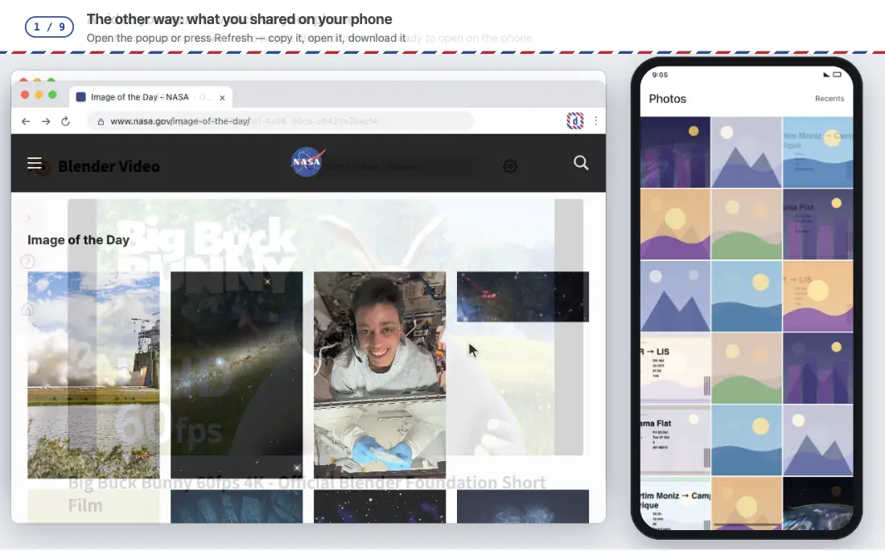

# dropit for Chrome

[English](./README.md) · **简体中文**

**浏览器里正在看的东西，一下就到你的其他设备上。**
一个页面、一段话、一张图、一份 PDF、一张截图：几秒后它就在 Obsidian 里、手机上、任何一个浏览器里等你。
支持 Chrome 和 Edge。



<sub>画面内容：<i>Big Buck Bunny</i> © Blender Foundation / Blender Institute（CC BY 3.0）· NASA「Image of the Day」与「Star Trails」（NASA/Anil Menon）· 《Attention Is All You Need》，Vaswani 等，arXiv:1706.03762。其余页面和文件是为演示自制的。</sub>

## 一下就到

| 你正在看… | 这样做 | 其他设备收到 |
|---|---|---|
| 一篇想在手机上接着看的文章 | 点 dropit 图标，按<kbd>回车</kbd> | 链接**连同标题和简介**，不是光秃秃一串网址 |
| 一段值得留下的话 | 选中，按 <kbd>Alt</kbd>+<kbd>Shift</kbd>+<kbd>S</kbd> | 这段文字，换行原样保留，末尾附上出处链接 |
| 一张图 | 在图上右键 → **dropit** →「投这张图片」 | 图片文件本身 —— 离线能打开，网站删了也还在 |
| 刚截的屏 | <kbd>⌃</kbd><kbd>⇧</kbd><kbd>⌘</kbd><kbd>4</kbd>，再 <kbd>Alt</kbd>+<kbd>Shift</kbd>+<kbd>D</kbd>、<kbd>⌘</kbd><kbd>V</kbd>、<kbd>回车</kbd> | 这张截图，图片文件 |
| 在 Chrome 里打开的 PDF | 点图标，按<kbd>回车</kbd> | PDF 文件本身，不是链接 |
| 页面里直接播放的视频文件 | 在视频上右键 → **dropit** →「投这个视频」 | 视频文件（[流媒体网站不行](#做不到的)） |
| 自己的一句话 | 点图标，打字，<kbd>回车</kbd> | 这句话 |

一路上什么都不用选：不选文件夹、不打标签、不选「发给谁」。投出去，你加入过的每台设备都会收到。

## 弹窗

点 dropit 图标，或按 <kbd>Alt</kbd>+<kbd>Shift</kbd>+<kbd>D</kbd>。打开就是输入框，直接打字。

- **框下面那行字总会告诉你，回车会投什么** ——「回车投这个页面：……」「回车投这段文字」「回车投 2 个文件和这段文字」。不用猜。
- **框是空的** → 投这个页面，带上标题和作者写的简介。在 PDF 上就是 PDF 文件本身。
- **页面上选中了文字？** 打开时已经填好，投出去会注明来自哪个页面。想先改改也行。
- **什么都能粘贴**：文字、链接（按链接投）、截图、在访达里复制的文件（<kbd>⌘</kbd><kbd>V</kbd>）。也可以点输入框里的回形针（「添加附件」）。
- **一次投好几样** —— 一段文字加最多 10 个文件 —— 对方收到的是一整份。
- <kbd>Shift</kbd>+<kbd>回车</kbd> 换行。用输入法选词时按的回车不会投出去。

投递时按钮变成「投递中」，信封一圈红蓝条纹滚动起来，一批会数着走（「正在投递 2/3…」）。
投完**弹窗不关**：框下显示「✓ 已投递 #71 · 14:07」，输入框清空，接着投下一样。

**最近投出**列出这个浏览器最近投的 5 样（不论从弹窗、右键菜单还是快捷键），新的在上：文字和链接有复制按钮，链接的标题点一下就打开。
创建账号或用配对码加入的浏览器里，每一行还写着投给了谁（「→ 全部」「→ 设备名」「→ 3 台」）。这份列表只存在这个浏览器自己的存储里，一周后或退出时清掉，不会发到任何地方。没投成时，列表上方出现一张淡红描边的卡片，写明原因，
带「重试」按钮，改动输入框后消失。

右上角的**太阳图标**收着其余的：「加一台设备」、「默认投给」（见下）、主题（跟随系统 / 浅色 / 深色）、源代码、反馈问题、隐私说明、退出。

## 选择投给哪些设备

在**创建账号或用配对码加入的浏览器**里，账号里有了两台或更多台能接收的其他设备之后，输入框右边的按钮块下面多出一条浅色的去向区，写着这次投给谁（「→ 全部」「→ Mac、Pixel」「→ 3 台」）。
不动它，就是投给你所有的设备，和以前一样。要选：

- **只这一次**：点去向区，出现一个清单「投给哪些设备」，已按你的默认勾好。取消不要的，再点底部的整行大按钮 —— 只有它才会发出。
  发完回到默认。不点它就关掉清单，什么都没变。至少保留 1 台。
- **每一次**：右上菜单 ›「默认投给」，勾选即保存。右键菜单和快捷键投递也按这个默认。
- **只存在这个浏览器上。** 全勾上存的是「全部」，以后新加的设备会自动并入；只勾一部分，存的就是这几台。
  退出、重装后回到「全部」。默认里的设备被移除了，会自动去掉并提示一次；一台都不剩就回到「全部」。
- 早先用只能投递的钥匙加入的浏览器读不了设备列表，只有「投递」，永远投给全部 ——
  除非你在那里[开启接收](#这里也能收)，它就拿到和现在加入的浏览器一样的完整权限。

## 加一台设备

投出去的东西得有地方收。在**创建账号或用配对码加入的浏览器**里，弹窗就能把手机、Obsidian 或另一台电脑加进来：

- **点完「创建新账号」**，弹窗里已经显示好 6 位配对码和二维码（也帮你复制好了）。用手机相机扫二维码，
  或者在 Obsidian、终端（`dropit pair <配对码>`）、另一个浏览器里输入这 6 位。之后的入口是顶部设备数旁边的 **+ 加一台设备**。
- **对方加入了，弹窗自己知道**：配对码收起，框下显示「✓ 新设备已加入：iPhone · 快捷指令」。
- **配对码 5 分钟有效、只能用一次**，倒计时就在码下面。点到别处弹窗会关，但码还在 —— 再打开弹窗，还是同一个码。
- **设备名额满了？** 会写明新设备加入时替换哪一台 —— 默认是最久没用的那台，也可以另选 —— 所以在另一台设备上加入还是一步。
- **加入时名额已满？** 新浏览器会说明设备数已达上限，并告诉你怎么办：在已有设备上先移除一台，或者（免费账号、且开放了付费版时）给一个升级链接。

只有早先用只能投递的钥匙加入的浏览器不显示这个入口，除非你在那里[开启接收](#这里也能收)。要出码，就在有完整权限的设备上出 ——
网页收件箱、Obsidian、`dropit code`，或者另一个浏览器。

## 这里也能收

**创建账号或用配对码加入的浏览器**也能列出你其他设备投来的内容，加入后立刻就能收。做得很朴素：**没有通知，也不在后台保持连接。**
打开弹窗，「最近收到」就会取回上次之后新来的；标题旁边的小箭头是**刷新**，再取一次。

- **只列别的设备投来的**，新的在上：最多 **50** 条，在这个浏览器自己的存储里留 **7 天**，不存在别处。
  这个浏览器自己投的，仍在「最近投出」里。退出、或钥匙失效，这份列表就清空。
- **文字**有复制按钮。**链接**点标题就打开，并写出网站名；只有 `http` 和 `https` 地址会打开
  （别的设备投来的其他形式的地址，只当文字显示，绝不打开）。**文件和图片**有下载按钮：点的那一刻才去要一条新的下载链接
  （链接只有几分钟有效，所以不存），再在新标签页里打开；超过保留期的文件会告诉你已经取不到了；
  免费账号（提供付费版时）还会看到免费版和付费版各保留多久，并带一个去付费版的链接，今天的下载次数用完时同样有。
- **第一次**会列出已经在等这个浏览器的内容（别的设备投来的最近 50 条），而不是从空白开始：
  在手机上投一样东西，再打开弹窗，正是试它的常见方式。不管哪种，都不会弹出任何东西。
- 每次刷新最多发几次请求；积压很多时，下一次接着取。

**用配对码加入，浏览器拿到的就是完整钥匙，加入后立刻能收** —— 不用再开启什么。只有用早先版本的扩展加入的浏览器，钥匙才是只能投递的。要在那里接收，打开右上角菜单 ›
**在这台浏览器上接收**（只有这样的浏览器才显示）。它会先说一句：*开启后，这台浏览器能读到你账号里的内容。*
然后填入一个有完整权限的设备给的配对码 —— 创建账号的浏览器、Obsidian、网页收件箱、`dropit code` ——
再点「同意并开启」。这个浏览器会在原来的位置重新加入一次：不多占设备名额，只能投递的旧钥匙作废、换成新的完整钥匙。
码被拒绝时什么都不会变，照常能投。

右上角菜单里有一行小字，写着这个扩展的版本，以及这个浏览器是「能收能发」还是「只能投递」；下面还有一行 `账号 xxxxxxxx`，是一个短码，用来认这个浏览器属于哪个账号（可以选中复制；服务较旧、没给这个码时不显示这一行）。在选「投给哪几台」的设备列表里，每台设备的第二行以它编号的最后四个字符开头，后面是最近在线时间（`bT5Q · 刚刚在线`），名字相同的两台也分得清。

## 右键

在页面上任何地方右键，都有一个 **dropit**。展开后是这里能投的东西，最具体的在前，「投这个页面」永远在最后一行：

| 在哪里右键 | **dropit** 展开后 |
|---|---|
| 选中的文字 | 投选中的文字 · 投这个页面 |
| 图片 | 投这张图片 · 投图片链接 · 投这个页面 |
| 带链接的图片 | 投这张图片 · 投图片链接 · 投这个链接 · 投这个页面 |
| 链接 | 投这个链接 · 投这个页面 |
| 指向文件的链接（PDF、ZIP、图片、视频、Office……） | 多一项「投链接指向的文件」 |
| 页面直接播放的视频或音频文件 | 投这个视频 / 投这段音频 · 投这个页面 |
| 其他任何地方 | 投这个页面 |

在工具栏的 dropit 图标上右键，有「把这个页面投进 dropit」。

## 两个快捷键

| 按键 | 效果 |
|---|---|
| <kbd>Alt</kbd>+<kbd>Shift</kbd>+<kbd>S</kbd> | **立刻投**，什么窗口都不弹：有选中就投选中的，没有就投这个页面（PDF 上投文件） |
| <kbd>Alt</kbd>+<kbd>Shift</kbd>+<kbd>D</kbd> | 打开弹窗，选中的文字已经在框里 |

Mac 上 <kbd>Alt</kbd> 就是 <kbd>⌥</kbd>。在 `chrome://extensions/shortcuts`（Edge：`edge://extensions/shortcuts`）里可以改。
从旧版本升级上来时，Chrome 有时没把快捷键设上 —— 去那里设一次就好。

## 投没投到，一眼就知道

- **右键或快捷键投完** —— 页面顶部弹一条小提示：「dropit · 已投递 #71」。
  没投成就是红框「dropit · 退回：……」，写明原因，停 5 秒。
- **在弹窗里** —— 框下显示「✓ 已投递 #71」；没投成是一张淡红描边的卡片，写明原因并带「重试」按钮，你写的内容原样留着。
- **图标上** —— 短暂亮蓝色 ✓ 或红色 ✗；这个浏览器还没加入账号时，一直亮着红色 **!**。
- **断网绝不会显示成功。** 路上连接被断（代理不稳、Wi-Fi 时好时坏），会先再试两次，才算失败。
- **手滑点了两下？** 一分钟内紧挨着投两次同样的东西，只存一份，照样提示已投递。
- **文件太大？** 超过你套餐单条上限的文件，在**下载之前**就告诉你，不用白等。
  免费账号遇到付费版装得下的文件，提示里会写明付费版的上限，并附一个升级链接。

## 到了那边是什么样

| 在哪儿收 | 投的页面 | 选中的文字 | 图片或文件 |
|---|---|---|---|
| [Obsidian](https://github.com/smart-kits/dropit-obsidian) | `[标题](链接)`，简介作为引用 | 这段文字，后面一行 `— [页面标题](链接)` | 存进附件文件夹，嵌在笔记里 |
| 网页收件箱 | 一张卡片：标题、网址、简介 | 这段文字，后面一行「来自 页面标题 ↗」 | 下载链接 |
| [终端](../cli/README.zh-CN.md)（`dropit watch`） | 一篇带标题和简介的 Markdown 笔记 | 文字加出处一行 | 文件原样保存 |

## 一分钟装好

1. **拿到它。** 还没上架 Chrome 应用商店：在 [dropit.smart-kits.xyz](https://dropit.smart-kits.xyz) 下载后解压，
   或者 `git clone https://github.com/smart-kits/dropit-client.git`，用里面的 `extension/` 文件夹。
2. **装上它。** 打开 `chrome://extensions`（Edge：`edge://extensions`），打开**开发者模式**，
   点**加载已解压的扩展程序**，选这个文件夹。想看到 ✓ 的话，把 dropit 图标固定到工具栏。
3. **加入你的账号。** 点图标。在一台已经在用的设备上调出配对码 —— 网页收件箱的「设备」页、
   Obsidian 的「设置 → dropit」、或者终端里 `dropit code`。
   把这 6 位填进邮戳条纹框里，点「同意并加入」；大小写、空格、`0` 和 `O` 搞混都没关系。
   框下面的三步（「怎么拿配对码」）说明了码从哪来。
   这是你的第一台设备？点「还没有账号？」旁边的「同意并创建新账号」—— 弹窗随即给出配对码，[把下一台设备加进来](#加一台设备)。
   如果这个网络今天已经建了很多账号，创建时可能要多等几秒（显示「正在准备账号…」），不会再让你去别处建。

**更新：** 把新版本解压到同一个文件夹覆盖，再在 `chrome://extensions` 点「重新加载」。
文件夹不变，扩展就还是同一个 —— 不用重新加入。

## 它能读什么、什么时候读

| 权限 | 用来做什么 |
|---|---|
| `activeTab` + `scripting` | 只针对你正在操作的标签页、只在你操作的那一刻：读它的标题、简介和选中的文字，取你右键的那张图或那个文件 |
| `contextMenus` | 右键菜单里的 **dropit** |
| `storage` | 这个浏览器的登录信息，以及它投出和收到的两份短列表，只存在这台电脑上 |
| `notifications` | 页面上显示不了提示时（`chrome://` 页面、应用商店）告诉你投递结果 —— 除此之外从不弹任何通知 |
| `declarativeNetRequestWithHostAccess` | 只对你允许过的网站（见下文）：扩展不得不自己去取文件时，说明你当时在哪个页面，和页面自己取时一样 —— 有些图床只认这个 |
| 可选：一次一个网站 | 只在某个网站不让页面交出文件时，弹一个只有一个按钮的小窗口问你 |

**安装时什么权限都不要** —— 你不操作，扩展读不了任何网站。
图片和文件**由页面自己去取**，和它平时加载的方式一样，所以绝大多数网站什么都不用多给。
极少数不肯的网站，才就这一个网站问你一次；随时可以在扩展的详情页里收回。

**账号是安全的。** 每个浏览器都是独立的一台设备。创建账号和用配对码加入，浏览器拿到的都是**完整权限**的钥匙 ——
它能[把你的其他设备加进来](#加一台设备)、[列出它们投来的内容](#这里也能收)；也和任何完整权限的钥匙一样，泄露了就能读你的内容，
所以在不是你自己的电脑上，用完记得退出。（用早先版本加入的浏览器，钥匙是只能投递的，直到你在里面开启接收。）钥匙只存在这台电脑上扩展自己的存储里，从不进入网页 ——
页面只负责交出文件内容。要断开这个浏览器，点弹窗右上角菜单里的「退出」（退出前会有一屏写明会清掉什么，未发出的文字不会保留），或者在别的设备上把它移除。

## 做不到的

- **流媒体视频**（YouTube、B 站和大多数视频网站）是几百个小片段边下边播，没有一个完整的文件，所以只有「投这个页面」。
  真想要文件，先用视频下载工具下好，再把文件投进来。
- **个别图床只给自家页面用。** 连说明来自哪个页面都不管用时，红框会直说，并建议改用「投图片链接」。
- **从桌面把文件拖到弹窗上**不行 —— 一点别处弹窗就关了。在访达里复制，再粘贴进弹窗，或者用回形针。
- **没有通知，也不实时。** 扩展只在你打开弹窗或点「刷新」时列出别的设备投来的内容，不在后台盯着。
  想一到就收到提醒，或者存成文件、笔记，用 [Obsidian](https://github.com/smart-kits/dropit-obsidian)、
  [终端](../cli/README.zh-CN.md)、手机 App 或网页收件箱。
- 桌面版 Chrome 没有系统分享面板：右键的 dropit、工具栏图标和两个快捷键，就是它的「分享」按钮。

## 开发者

```
extension/
├── manifest.json     Manifest V3
├── background.js     右键菜单、快捷键、投递、页面上的提示、角标与通知
├── popup.html/.js    弹窗：加入、投递输入框、进度、最近投出、菜单、加一台设备
├── recent.js         这个浏览器最近投出的几条，存在它自己的存储里
├── receive.js        别的设备投来的内容：从记住的位置往后取、列表（50 条、7 天）、给文件要一条新链接
├── targets.js        选设备的纯逻辑：默认值、与设备列表核对、投给谁怎么写短
├── icons.js          弹窗的线性图标
├── pairing.js        加设备的纯逻辑：哪种钥匙能加、名额满时替换哪台、什么时候停止查看
├── qr.js             极小的二维码编码器（取自 Obsidian 插件，MIT），测试里用指纹钉住
├── popup.css         弹窗样式：航空信封、卡片、浅色和深色（与授权小窗口共用）
├── payload.js        纯逻辑：回车投什么、元信息与大小、菜单、成批、错误文案
├── page.js           在页面里运行：标题和简介、选中的文字、取文件、页面提示
├── api.js            请求、重试、退回内置地址
├── grant.html/.js    就一个网站申请权限的小窗口
├── i18n.js           界面文案（英文 / 简体中文）
└── fonts/            标签字体（SIL 开放字体许可证，许可文件同目录）
```

没有构建步骤 —— 改完在 `chrome://extensions` 点「重新加载」。测试（在仓库根目录）：
`node test/extension.test.mjs` 和 `node test/i18n.test.mjs`。
界面跟随浏览器语言：默认英文，浏览器设为中文时显示简体中文。


## 其他设备

你的每台设备都有对应的 dropit 客户端，用配对码加入同一个账号。哪些能发、哪些能收、怎么搭配：
[所有客户端](../README.zh-CN.md#你的每台设备上)。或者在任何设备上打开 [dropit.smart-kits.xyz](https://dropit.smart-kits.xyz)，它会推荐一个。

## 许可证

[MIT](../LICENSE) · 字体：[Barlow Condensed](./fonts/OFL-barlow-condensed.txt) 和 [得意黑](./fonts/OFL-smiley-sans.txt) 的子集，SIL 开放字体许可证
